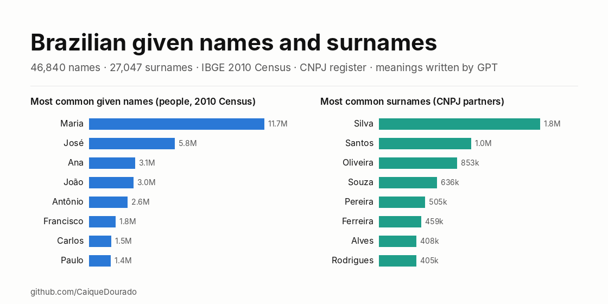
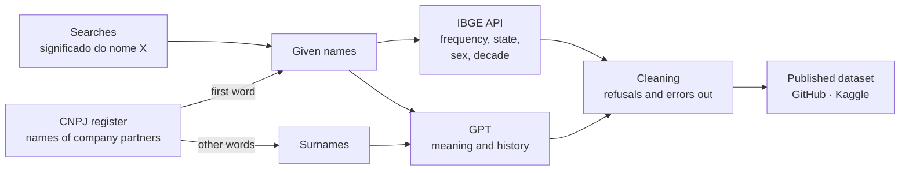

# Nomes e sobrenomes do Brasil · Brazilian given names and surnames

[](https://github.com/CaiqueDourado/nomes-e-sobrenomes-brasil/actions/workflows/validate.yml)
[](LICENSE-DATA.md)
[](LICENSE)
[](https://www.kaggle.com/datasets/caiquedourado/nomes-e-sobrenomes-brasil)

[Leia em português](README.pt-BR.md)



46,840 Brazilian given names and 27,047 surnames, each with how many company partners in the CNPJ register carry it, IBGE 2010 Census data for the names (rank, frequency, state where it is most common, related spellings, women and men, decade of birth), six phonetic and fingerprint keys, and a meaning or family history **written by OpenAI models in 2023**, with the model named on every row.

It is the database behind **nomessobrenomes.com**, a 90,000-page site the author built in 2023. Two uses:

- **A list of Brazilian names with real frequencies**, for name parsing, gender or region features, test data, autocomplete.
- **A corpus of language-model output about names**, for studying hallucination: plausible etymologies that are wrong, invented genealogies, templates the model repeats, and how text-davinci-002 and gpt-3.5 differ on the same task.

| File | Rows | Columns | Formats |
|---|---|---|---|
| `nomes` | 46,840 | 31 | CSV · Parquet |
| `sobrenomes` | 27,047 | 11 | CSV · Parquet |

## Preview

| name | cnpj_partners | ibge_rank | ibge_top_state | model | meaning |
|---|---:|---:|---|---|---|
| José | 1,015,442 | 2 | Alagoas | text-davinci-002 | O nome Jose significa "Deus salva". *(Joseph means "God will add")* |
| Tadeu | 4,716 | 905 | Paraná | gpt-3.5 | O nome Tadeu tem origem hebraica e significa "o corajoso"… |
| Araken | 287 | 23,359 | Rio Grande do Norte | text-davinci-002 | Araken é um nome masculino de origem japonesa. *(wrong: it is Tupi)* |

## Use it

```python
import pandas as pd

base = "https://raw.githubusercontent.com/CaiqueDourado/nomes-e-sobrenomes-brasil/main/data/"
names = pd.read_parquet(base + "nomes.parquet")
surnames = pd.read_parquet(base + "sobrenomes.parquet")

names.nlargest(10, "ibge_frequency")[["name", "ibge_frequency", "ibge_top_state"]]
```

```sql
-- DuckDB: names that sound alike (same Portuguese Metaphone key)
SELECT key_metaphone, list(name ORDER BY ibge_frequency DESC NULLS LAST)[1:6] AS top_spellings
FROM 'data/nomes.parquet'
GROUP BY key_metaphone HAVING count(*) > 3
ORDER BY sum(coalesce(ibge_frequency, 0)) DESC LIMIT 10;
```

## What is inside

| Group | `nomes` | `sobrenomes` |
|---|---|---|
| Name | `name_id`, `name`, `source` | `surname_id`, `surname` |
| Frequency | `cnpj_partners`, `ibge_rank`, `ibge_frequency`, `ibge_percent`, `ibge_top_state`, `ibge_top_state_per_100k`, `ibge_spellings` | `cnpj_partners` |
| Sex and decade of birth | `ibge_female`, `ibge_male`, `ibge_share_female`, `ibge_peak_decade`, `ibge_born_before_1930` … `ibge_born_2000s` | — |
| Text written by a model | `meaning`, `model` | `history`, `model` |
| Keys for matching | `key_metaphone`, `key_fingerprint`, `key_tokens`, `key_tokens_fingerprint`, `key_ngram`, `key_soft` | same six |

Every column is described in the **[data dictionary](docs/data-dictionary.md)** ([pt-BR](docs/data-dictionary.pt-BR.md)).

## How it was built



Given names came from the first word of company partners' names in the CNPJ register (Receita Federal open data, 3 or more people per name), from searches for "significado do nome X" and from the spellings the IBGE names API lists. Surnames are the other words of the partners' names. Each name was looked up in the IBGE names API (next section), a C# routine computed six matching keys per row, and OpenAI models wrote a meaning per name and a history per surname.

For this release, only rows with a usable text were kept: refusals ("Não há um significado específico…", and every text that opens by saying no meaning is known), texts that drift into English, company words and codes were removed, repeated sentences from model loops were cut, accent variants were merged. Step by step, with counts: [methodology](docs/methodology.md).

## The site: nomessobrenomes.com (2023)

[](https://web.archive.org/web/20250610174857/https://nomessobrenomes.com/qual-o-significado-do-nome-alan-gustavo)

*nomessobrenomes.com, [archived on the Wayback Machine](https://web.archive.org/web/20250610174857/https://nomessobrenomes.com/qual-o-significado-do-nome-alan-gustavo).*

A programmatic SEO site of about **90,000 static pages**, built by the author from this table:

| Part | How it worked |
|---|---|
| Pages | One per name ("Qual o significado do nome X?"), one per surname ("Qual a história e origem do sobrenome X?") and one blog post per state with its 100 most common names (IBGE data, with the state flag) |
| Generation | SQL Server stored procedures assembled each page's data; a C# generator wrote plain HTML files. No database or server at request time |
| Hosting | **Google Cloud Storage** as a static website: serverless, no server to maintain, scales with traffic |
| Performance | 100% mobile-friendly, top **Core Web Vitals** scores (static HTML, no client-side framework) |
| Structured data | **JSON-LD** on every page: `FAQPage`, `ItemList`, `WebSite`, `BreadcrumbList` and `Article` |
| Images | Banners and social images (stories and post formats) generated in C# for every name |
| Similar names | "Nomes parecidos" linked through the six keys (same Metaphone, fingerprint, stems…) |
| Text quality | SQL checks on every model answer before publishing: refusals, answers in English, n-grams of 2–5 words to spot the model's stock phrases, repeated words and sentences, answers cut by the token limit (trimmed to the last full sentence) |
| URLs | Slugs from the title, numbered on collision, with Windows reserved names (`con`, `prn`) escaped, since pages were files on disk |

The data sources were the CNPJ register (Receita Federal), the IBGE names API and keyword lists; the texts came from text-davinci-002 and later gpt-3.5. Details in [methodology](docs/methodology.md#the-site).

## The IBGE names API

Every given name was looked up in the **IBGE names API**, the public service of Brazil's statistics institute that answers from the **2010 Census** (people counted by first name). No key, no login. In 2023 the site called only the basic endpoint; for this release the remaining endpoints were called with [ibge-nomes](https://github.com/CaiqueDourado/ibge-nomes), a client written for it, to fill sex and decade of birth.

```text
GET https://servicodados.ibge.gov.br/api/v1/censos/nomes/basica?nome=caique
```

```json
[{"rank":529,"nome":"CAIQUE","freq":50902,"percentual":0.0278,"ufMax":"Bahia","ufMaxProp":"68.3960","regiao":0,"sexo":"","nomes":"CAYQUE,KAIQUE,KAYQUE"}]
```

| API field | Column here | What it means |
|---|---|---|
| `rank` | `ibge_rank` | Position among all first names in the Census (1 = Maria) |
| `freq` | `ibge_frequency` | People with exactly this spelling in 2010 |
| `percentual` | `ibge_percent` | Share of the population, in percent |
| `ufMax` | `ibge_top_state` | State where the name is proportionally most common |
| `ufMaxProp` | `ibge_top_state_per_100k` | People with the name per 100,000 inhabitants of that state |
| `nomes` | `ibge_spellings` | Related spellings IBGE lists for this name (`,` here becomes `\|`) |
| `regiao`, `sexo` | — | Echo of the query filters; the 2023 calls had none, so `0` and empty |

```text
GET https://servicodados.ibge.gov.br/api/v2/censos/nomes/caique|maria?sexo=F
```

The v2 endpoint answers how many people with each name were born in each decade (before 1930 to the 2000s), for several names in one call, optionally only women (`sexo=F`) or men (`sexo=M`). Three calls per batch of 20 names gave:

| Columns | What they hold |
|---|---|
| `ibge_female`, `ibge_male`, `ibge_share_female` | People of each sex with this spelling, and the share of women |
| `ibge_born_before_1930` … `ibge_born_2000s` | People with this spelling born in each decade (alive in 2010) |
| `ibge_peak_decade` | The decade with the most births of the name |

Each spelling has its own count; `nomes` only points to related spellings (Caique 50,902, Kaique 43,883, Cayque 475). Spellings in `nomes` that were not yet in the table were added as names of their own (`source = ibge_variant`). Names the API does not know (rare spellings, and every compound name, since the Census counts first names only) have the IBGE columns empty. Details in [methodology](docs/methodology.md#the-ibge-names-api).

```python
from ibge_nomes import IbgeNomes   # pip install "ibge-nomes @ git+https://github.com/CaiqueDourado/ibge-nomes"

ibge = IbgeNomes()
ibge.basic("Caique")["freq"]                  # 50902
ibge.by_decade(["Caique"], sex="F")           # women named Caique, per decade of birth
```

## Data quality

**The texts are not facts.** No person reviewed them. The model says Araken is Japanese (it is Tupi), places the city of Cerqueira César "in the north of Portugal" (it is in São Paulo), writes the Barboza history about Barbosa, and gives the Carrero family a founder born in Seville in 1573 followed by five generations of "successful merchants", all invented. These examples stay in the data on purpose. Full report, including what was fixed and the known bug in `key_fingerprint`: [data-quality.md](docs/data-quality.md).

**Privacy.** Only counts per name or per surname are published; no full name, no company. Surnames shared by fewer than 3 partners are left out.

## Repository layout

```text
data/          nomes.csv/.parquet, sobrenomes.csv/.parquet, dataset-metadata.json (Kaggle)
schema/        column definitions and dataset metadata: the single source for docs and Kaggle
scripts/       build.py (export → data), validate.py (checks), docs.py (dictionaries + Kaggle), make_figures.py
notebooks/     eda.ipynb, exploratory analysis
docs/          data dictionary, methodology, data quality, Kaggle description, images
stats.json     what each build step removed, rows per model and source
```

The SQL Server export is not redistributed. With it, `python scripts/build.py --raw <folder>` rebuilds `data/`; `python scripts/validate.py` runs the checks that CI runs on every push.

## Related

- [ibge-nomes](https://github.com/CaiqueDourado/ibge-nomes): the client used for the IBGE names API.
- [DedupKit](https://github.com/CaiqueDourado/DedupKit): the matching library, with the fixed fingerprint keyer and the Portuguese phonetic key.
- [Municípios e estados do Brasil](https://github.com/CaiqueDourado/municipios-e-estados-do-brasil): IBGE codes, Census and maps, for the state names in `ibge_top_state`.
- [Catálogo de produtos do e-commerce brasileiro](https://github.com/CaiqueDourado/catalogo-produtos-ecommerce-brasil), from the same data lake.

## License

Data: [CC BY 4.0](LICENSE-DATA.md). Code: [MIT](LICENSE). Cite as in [CITATION.cff](CITATION.cff).

## Author

**Caique Dourado**: 20 years building crawlers, data pipelines and programmatic SEO in .NET and SQL Server. More at [github.com/CaiqueDourado](https://github.com/CaiqueDourado).
