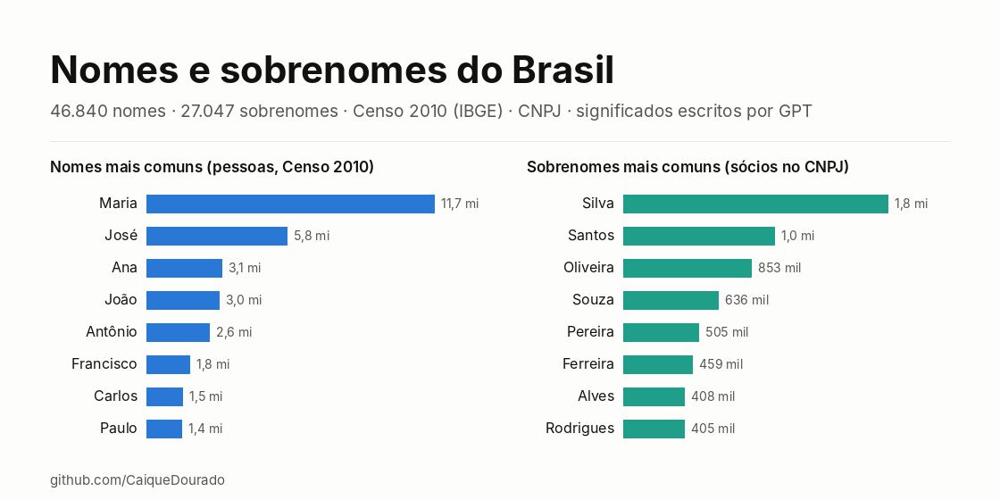

# Nomes e sobrenomes do Brasil

[](https://github.com/CaiqueDourado/nomes-e-sobrenomes-brasil/actions/workflows/validate.yml)
[](LICENSE-DATA.md)
[](LICENSE)
[](https://www.kaggle.com/datasets/caiquedourado/nomes-e-sobrenomes-brasil)

[Read in English](README.md)



São 46.840 nomes e 27.047 sobrenomes brasileiros. Cada um traz quantos sócios do cadastro CNPJ o têm, e os nomes também trazem dados do Censo 2010 do IBGE: posição, frequência, estado onde o nome é mais comum e grafias relacionadas. Há ainda seis chaves fonéticas e de fingerprint e um significado ou história da família **escrito por modelos da OpenAI em 2023**, com o modelo indicado em cada linha.

É o banco por trás do **nomessobrenomes.com**, um site de 90 mil páginas que o autor fez em 2023. Dois usos:

- **Lista de nomes brasileiros com frequência real**, para separar nome e sobrenome, criar atributos de gênero ou região, gerar dados de teste e montar autocompletar.
- **Corpus de textos de modelos de linguagem sobre nomes**, para estudar alucinação: etimologias plausíveis e erradas, genealogias inventadas, fórmulas que o modelo repete e a diferença entre o text-davinci-002 e o gpt-3.5 na mesma tarefa.

| Arquivo | Linhas | Colunas | Formatos |
|---|---|---|---|
| `nomes` | 46.840 | 18 | CSV · Parquet |
| `sobrenomes` | 27.047 | 11 | CSV · Parquet |

## Prévia

| name | cnpj_partners | ibge_rank | ibge_top_state | model | meaning |
|---|---:|---:|---|---|---|
| José | 1.015.442 | 2 | Alagoas | text-davinci-002 | O nome Jose significa "Deus salva". *(José quer dizer "Deus acrescentará")* |
| Tadeu | 4.716 | 905 | Paraná | gpt-3.5 | O nome Tadeu tem origem hebraica e significa "o corajoso"… |
| Araken | 287 | 23.359 | Rio Grande do Norte | text-davinci-002 | Araken é um nome masculino de origem japonesa. *(errado: é tupi)* |

## Como usar

```python
import pandas as pd

base = "https://raw.githubusercontent.com/CaiqueDourado/nomes-e-sobrenomes-brasil/main/data/"
nomes = pd.read_parquet(base + "nomes.parquet")
sobrenomes = pd.read_parquet(base + "sobrenomes.parquet")

nomes.nlargest(10, "ibge_frequency")[["name", "ibge_frequency", "ibge_top_state"]]
```

```sql
-- DuckDB: nomes que soam parecido (mesma chave Metaphone português)
SELECT key_metaphone, list(name ORDER BY ibge_frequency DESC NULLS LAST)[1:6] AS grafias
FROM 'data/nomes.parquet'
GROUP BY key_metaphone HAVING count(*) > 3
ORDER BY sum(coalesce(ibge_frequency, 0)) DESC LIMIT 10;
```

## O que tem dentro

| Grupo | `nomes` | `sobrenomes` |
|---|---|---|
| Nome | `name_id`, `name`, `source` | `surname_id`, `surname` |
| Frequência | `cnpj_partners`, `ibge_rank`, `ibge_frequency`, `ibge_percent`, `ibge_top_state`, `ibge_top_state_per_100k`, `ibge_spellings` | `cnpj_partners` |
| Texto escrito por modelo | `meaning`, `model` | `history`, `model` |
| Chaves para casamento | `key_metaphone`, `key_fingerprint`, `key_tokens`, `key_tokens_fingerprint`, `key_ngram`, `key_soft` | as mesmas seis |

Cada coluna está descrita no **[dicionário de dados](docs/data-dictionary.pt-BR.md)** ([EN](docs/data-dictionary.md)).

## Como foi feito

Os nomes vieram de três fontes: a primeira palavra do nome dos sócios no cadastro CNPJ (dados abertos da Receita Federal, com 3 ou mais pessoas por nome), buscas por "significado do nome X" e as grafias listadas pela API de nomes do IBGE. Cada nome foi consultado na API do IBGE (Censo 2010). Os sobrenomes são as outras palavras do nome dos sócios. Uma rotina em C# calculou seis chaves por linha, e modelos da OpenAI escreveram um significado para cada nome e uma história para cada sobrenome. O site foi gerado em HTML estático a partir dessa tabela.

[](https://web.archive.org/web/20250610174857/https://nomessobrenomes.com/qual-o-significado-do-nome-alan-gustavo)

*nomessobrenomes.com, [arquivado no Wayback Machine](https://web.archive.org/web/20250610174857/https://nomessobrenomes.com/qual-o-significado-do-nome-alan-gustavo).*

Nesta versão ficaram só as linhas com texto aproveitável. Saíram as recusas ("Não há um significado específico…" e todo texto que começa dizendo que não se conhece o significado), os textos que viram inglês no meio, as palavras de razão social e os códigos de empresa. As frases repetidas pelos laços do modelo foram cortadas, e as variantes de acento, unidas. O passo a passo, com as contagens, está na [metodologia](docs/methodology.md) (em inglês).

## A API de nomes do IBGE

Cada nome foi consultado na **API de nomes do IBGE**, o serviço público que responde a partir do **Censo 2010** (pessoas contadas pelo primeiro nome). Uma chamada por nome, sem chave e sem login:

```text
GET https://servicodados.ibge.gov.br/api/v1/censos/nomes/basica?nome=caique
```

```json
[{"rank":529,"nome":"CAIQUE","freq":50902,"percentual":0.0278,"ufMax":"Bahia","ufMaxProp":"68.3960","regiao":0,"sexo":"","nomes":"CAYQUE,KAIQUE,KAYQUE"}]
```

| Campo da API | Coluna aqui | O que significa |
|---|---|---|
| `rank` | `ibge_rank` | Posição entre todos os primeiros nomes do Censo (1 = Maria) |
| `freq` | `ibge_frequency` | Pessoas com exatamente essa grafia em 2010 |
| `percentual` | `ibge_percent` | Percentual da população |
| `ufMax` | `ibge_top_state` | Estado onde o nome é proporcionalmente mais comum |
| `ufMaxProp` | `ibge_top_state_per_100k` | Pessoas com o nome a cada 100 mil habitantes desse estado |
| `nomes` | `ibge_spellings` | Grafias relacionadas que o IBGE lista para esse nome (a `,` virou `\|`) |
| `regiao`, `sexo` | — | Ficaram de fora: as chamadas não usaram filtro de região nem de sexo, então vieram `0` e vazio |

Cada grafia tem a própria contagem; `nomes` só aponta as grafias relacionadas (Caique 50.902, Kaique 43.883, Cayque 475). As grafias de `nomes` que ainda não estavam na tabela entraram como nomes próprios (`source = ibge_variant`). Nomes que a API não conhece (grafias raras e todo nome composto, porque o Censo conta só o primeiro nome) ficam com as colunas do IBGE vazias. Detalhes na [metodologia](docs/methodology.md#the-ibge-names-api).

```python
import requests

r = requests.get("https://servicodados.ibge.gov.br/api/v1/censos/nomes/basica", params={"nome": "caique"}, timeout=30)
r.json()[0]["freq"]   # 50902
```

## Qualidade dos dados

**Os textos não são fatos.** Ninguém os revisou. Alguns exemplos de erros do modelo:

- diz que Araken é japonês, quando é tupi;
- põe a cidade de Cerqueira César "no norte de Portugal", quando ela fica em São Paulo;
- escreve a história dos Barboza falando dos Barbosa;
- dá aos Carrero um fundador nascido em Sevilha em 1573, seguido de cinco gerações de "comerciantes bem-sucedidos", tudo inventado.

Esses exemplos ficaram na base de propósito. O relatório completo está em [data-quality.md](docs/data-quality.md). Ele mostra o que foi corrigido e o bug conhecido de `key_fingerprint`.

**Privacidade.** Só são publicadas contagens por nome ou por sobrenome: nenhum nome completo, nenhuma empresa. Sobrenomes com menos de 3 sócios ficaram de fora.

## Estrutura do repositório

```text
data/          nomes.csv/.parquet, sobrenomes.csv/.parquet, dataset-metadata.json (Kaggle)
schema/        definição das colunas e metadados: fonte única da documentação e do Kaggle
scripts/       build.py (exportação → data), validate.py (checagens), docs.py (dicionários + Kaggle), make_figures.py
notebooks/     eda.ipynb, análise exploratória
docs/          dicionário de dados, metodologia, qualidade, descrição do Kaggle, imagens
stats.json     o que cada etapa removeu, linhas por modelo e por origem
```

A exportação do SQL Server não é redistribuída. Com ela, `python scripts/build.py --raw <pasta>` refaz `data/`. As checagens que o CI roda a cada push estão em `python scripts/validate.py`.

## Relacionados

- [DedupKit](https://github.com/CaiqueDourado/DedupKit): a biblioteca de casamento, com o fingerprint corrigido e a chave fonética em português.
- [Municípios e estados do Brasil](https://github.com/CaiqueDourado/municipios-e-estados-do-brasil): códigos do IBGE, Censo e mapas, para os estados de `ibge_top_state`.
- [Catálogo de produtos do e-commerce brasileiro](https://github.com/CaiqueDourado/catalogo-produtos-ecommerce-brasil), do mesmo data lake.

## Licença

Dados: [CC BY 4.0](LICENSE-DATA.md). Código: [MIT](LICENSE). Para citar, veja [CITATION.cff](CITATION.cff).

## Autor

**Caique Dourado**: 20 anos construindo crawlers, pipelines de dados e SEO programático em .NET e SQL Server. Mais em [github.com/CaiqueDourado](https://github.com/CaiqueDourado).
