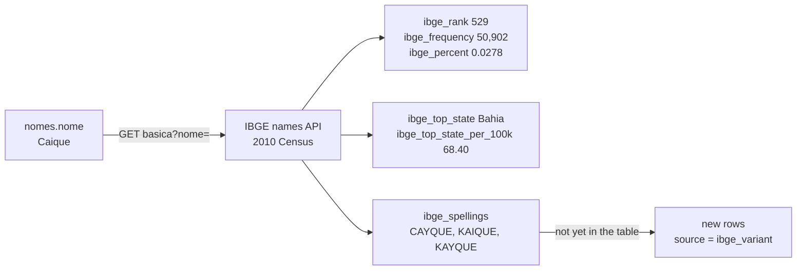

# Methodology

How the data was collected in 2023 for the site **nomessobrenomes.com**, and how this release was built from it in 2026.

## The site

Nomes e Sobrenomes (2023) was a static site of about 90,000 pages: one page per given name ("Qual o significado do nome X?"), one per surname ("Qual a história e origem do sobrenome X?") and a blog post per state with its 100 most common names. Everything came out of one SQL Server database (`significado_dos_nomes`) and a C# generator that wrote plain HTML files, banners and JSON-LD (FAQ, ItemList, Breadcrumbs, Article). An archived page: [qual-o-significado-do-nome-alan-gustavo](https://web.archive.org/web/20250610174857/https://nomessobrenomes.com/qual-o-significado-do-nome-alan-gustavo).

## 2023: where each column came from

```mermaid
flowchart LR
    A[CNPJ register<br/>company partners] -->|first word, 3+ people| N[nomes]
    A -->|other words, 2+ people| S[sobrenomes]
    B[Searches<br/>"significado do nome X"] --> N
    N -->|name| I[IBGE Nomes API<br/>2010 Census]
    I -->|rank, frequency, top state| N
    I -->|other spellings| N
    N --> K[C# keyers<br/>6 keys per row]
    S --> K
    N --> G[OpenAI<br/>text-davinci-002, then gpt-3.5]
    S --> G
    G -->|significado, historia| N & S
```

1. **Given names from the CNPJ register.** The first word of every company partner's name (`cnpj_dados_socios_pj.nome_socio`, open data from Receita Federal), capitalised, without stopwords, kept when 3 or more partners share it. The count is `cnpj_partners`.
2. **Given names from searches.** Keyword lists (DataForSEO and the author's own search patterns) with the form "significado do nome X". The name is the text after "significado do nome"; rows with words such as *bíblico*, *japonês*, *numerologia* or *pokémon* were left out. These have no CNPJ count (`source = search`).
3. **Surnames.** Every word of the partner's name except the first, aggregated; company words (LTDA, EIRELI, HOLDING…) were removed by hand queries.
4. **IBGE.** Each given name was sent to the IBGE names API (next section). Spellings listed by IBGE that were not yet in the table were added as new names (`source = ibge_variant`, ids from 379,876 on).
5. **Keys.** A C# routine computed six keys per row (metaphone, fingerprint, tokens, tokens fingerprint, n-gram, soft), used to link similar names on the site ("nomes parecidos"). The pairs table (7 million pairs for names, 7.7 million for surnames) is not published: the keys rebuild it with one self-join.
6. **Texts.** Each name was sent to OpenAI with a prompt asking for its meaning, and each surname for its history. The first round used **text-davinci-002** (`significado`, `historia`); a second round with **gpt-3.5** filled `significado_chatGPT` / `historia_chatGPT`. In the export, 59,214 names and 14,947 surnames have the same text in both columns, and 978 names have only the gpt-3.5 one. The answers were cleaned with SQL queries that look for refusals and model talk ("como uma IA", "não há um significado específico", "infelizmente"…).

## The IBGE names API

IBGE (Instituto Brasileiro de Geografia e Estatística) publishes the first names counted in the **2010 Census** through a free REST service, with no key. The 2023 routine (`pega-dados-nomes-ibge` in the crawler) called the basic endpoint once per name and saved the answer in the `ibge_*` columns:

```text
GET https://servicodados.ibge.gov.br/api/v1/censos/nomes/basica?nome=caique
```

```json
[{"rank":529,"nome":"CAIQUE","freq":50902,"percentual":0.0278,"ufMax":"Bahia","ufMaxProp":"68.3960","regiao":0,"sexo":"","nomes":"CAYQUE,KAIQUE,KAYQUE"}]
```



What each field means and how it was handled:

| API field | Column | Meaning | Handling |
|---|---|---|---|
| `rank` | `ibge_rank` | Position among all first names in the Census, 1 = most common | Text in 2023, integer here |
| `freq` | `ibge_frequency` | People with exactly this spelling | Integer |
| `percentual` | `ibge_percent` | Share of the population, in percent | Stored with comma decimal (`"0,0278"`), float here |
| `ufMax` | `ibge_top_state` | State where the name has the highest share of the population (not the largest count) | Empty string → empty |
| `ufMaxProp` | `ibge_top_state_per_100k` | People with the name per 100,000 inhabitants of that state | Float |
| `nomes` | `ibge_spellings` | Related spellings IBGE lists for the name | `,` → `\|` |
| `regiao` | — | Region of the query (0 = Brazil) | Always 0, because the call had no region filter; left out |
| `sexo` | — | Sex of the query | Always empty, because the call had no sex filter; left out |

Things to know when using these columns:

- **Each spelling is counted on its own.** Caique has 50,902 people, Kaique 43,883, Cayque 475; `ibge_spellings` only links them. To count everyone with any spelling of a name, add up the frequencies of the spellings listed.
- **Coverage.** 47% of the published names have no IBGE data: the API returns an empty list for names it does not have (rare spellings, compound names such as `Maria Júlia`: none of the 2,390 compound names has IBGE data, since the Census counts first names only).
- **Not used in 2023.** The API also answers by sex and by region, and other endpoints give the frequency by decade of birth. The 2023 calls did not use them, which is why `regiao` and `sexo` carry no information. Filling them in is the natural next version.

## 2026: building this release

`scripts/build.py` reads the export of the two tables and writes `data/`. The export itself is not redistributed. Steps, with the counts in `stats.json`:

| Step | Rule | Names | Surnames |
|---|---|---:|---:|
| Export | all rows | 172,179 | 279,098 |
| Partner cut | surnames need 3 or more partners, like names | — | 60,263 out (2,667 had a text) |
| No text | the model was never asked, or the answer was erased in 2023 | 82,975 out | 188,821 out |
| Refusal | the site's own refusal patterns, texts under 20 characters, and texts that open by saying no meaning or history is known ("Não há um significado claro para o nome X. É possível que…") | 42,078 out | 1,513 out |
| English | more than 15% common English words ("data back to the 12th century") | 44 out | 1,263 out |
| Not a name | characters other than letters, spaces, hyphen and apostrophe (`Mercadolivre.com`, `M2K`) | 147 out | 173 out |
| Company word | words of company names taken as surnames (`Limitada`, `Servicos`, `Transportes`) | 17 out | 17 out |
| Accent variants | rows that differ only by accents merge into one; the spelling with more accents wins | 78 merged | 1 merged |
| **Published** | | **46,840** | **27,047** |

Other changes to the kept rows:

- **Model.** `model` is `gpt-3.5` when the gpt-3.5 column has a text, `text-davinci-002` otherwise. Texts that start with blank lines (the shape of a davinci completion) are all in the second group, which supports the split.
- **Repeated sentences.** A sentence identical to an earlier one in the same text is removed. This fixes the loops where the model wrote the same sentence over and over (6,220 sentences in 433 surname histories, 5 in names). The site did the same fix on its pages with `ReplaceAllOccurrences`.
- **Spacing.** Leading blank lines removed, spaces collapsed, paragraphs kept as `\n`.
- **Capitalisation.** Names stored in capitals (`ANA`) are written as `Ana`.
- **Spelling.** Four frequent names had wrong accents in the CNPJ export: `António`, `Joâo`, `Claúdia`, `Diêgo` became `Antônio`, `João`, `Cláudia`, `Diego` and merged with the same name from searches.
- **IBGE numbers.** Stored as text with comma decimals in 2023; typed here.

`scripts/validate.py` checks the result in CI; `scripts/docs.py` writes the data dictionaries and the Kaggle metadata from `schema/`.

## Privacy

The CNPJ register is public, but it is a list of people. Only counts per given name or per surname are published, never a full name or anything linking a name to a company. Surnames with fewer than 3 partners are left out, the same cut the 2023 site used for names, so no row describes a small group of people. The model texts sometimes mention people (the invented "Pedro Carrero" of Seville); they are fiction written by the model, see [data-quality.md](data-quality.md).
